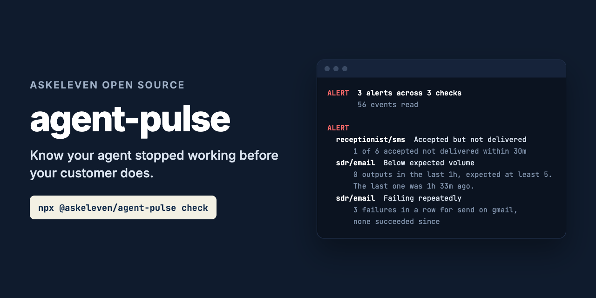

# agent-pulse



**Know your agent stopped working before your customer does.**

```bash
npx @askeleven/agent-pulse check --rules pulse.json --events events.jsonl
```

Errors are the easy case. Something throws, your error tracker lights up, someone looks.
The outage that hurts writes nothing at all. The agent stops sending, the scheduler keeps
ticking, every health check stays green, and the first person to notice is a customer
asking why nobody called them back.

agent-pulse alerts on missing activity. Your agents append one line to a log for each
thing they do. A rules file says what they should be doing: this many emails an hour on
weekday mornings, some sign of life every ten minutes, texts delivered within half an
hour. Run it from cron and it tells you, and your Slack channel, what is missing.

Zero dependencies. Nothing leaves your machine except the webhook and heartbeat URLs you
give it.

---

## What it catches

| Finding | What it means | Severity |
|---|---|---|
| `no_events` | The event log is missing or empty. Nothing is recording anything. | Alert |
| `silent` | No events at all for an agent and capability in `heartbeat.every`. | Alert |
| `below_expected` | Fewer than `expect.min` outputs in the last `expect.per`, inside the working window. | Alert |
| `failure_streak` | `streak.failures` failures in a row for one target and action. | Alert |
| `auth_failure`, `config_failure`, `quota_exhausted` | A failure of that class, alerted on the first one. | Alert |
| `undelivered` | A message was accepted by the provider but not delivered within `delivery.within`. | Alert |
| `malformed_events` | Lines in the log that could not be read. They are skipped. | Warn |
| `at_cap` | Volume is low because a designed limit was reached. Not an outage. | Info |

**Streaks are kept per target and action.** An agent whose inbox reads keep succeeding
while every send fails is failing. A success only clears failures for the same target and
action, so the reads cannot hide the sends.

**Error classes change what alerts.** On a `failed` event, `error_class` decides:

| `error_class` | Alerts |
|---|---|
| `auth`, `config`, `quota` | On the first one, until the same target and action succeeds |
| `transient`, `rate_limit`, missing, or anything else | Only through `streak` |
| `input` | Never. One bad record is not the agent's health, and it does not count toward a streak |

`healthy` is false, and the exit code is 1, only when there is an alert. Warnings and info
are reported but do not fail the check.

## What it does not do

**It does not watch your agent.** It reads the log your agent writes. If the agent never
writes to it, that shows up as `no_events` or `silent`, which is the point, but agent-pulse
cannot tell you why.

**It does not run on a schedule by itself.** It evaluates once and exits. Cron, a systemd
timer, or your CI scheduler runs it. If that stops, see
[Watching the watchdog](#watching-the-watchdog).

**It does not rotate or trim the log.** It reads the whole file on each run. Keep it to
what the longest rule needs (a day or two is plenty) with logrotate or similar.

**It is not a metrics system.** No graphs, no history, no dashboards. It answers one
question: is anything missing right now.

---

## Events

One JSON object per line:

```json
{"ts":"2026-09-28T13:03:00Z","agent":"sdr","capability":"email","type":"action","target":"gmail","action":"send","id":"msg-1"}
```

| Field | |
|---|---|
| `ts` | ISO 8601 time or epoch milliseconds. Required. |
| `agent` | Which agent. Required. |
| `capability` | What it was doing. Required. Use one capability per thing whose volume you want counted: sends and inbox reads are two capabilities. |
| `type` | Required. `run`, `action`, `accepted`, `delivered` or `failed`. |
| `target` | The system acted on: a provider, integration or inbox. Not an individual recipient, or every failure would have its own streak. |
| `action` | Such as `send` or `read`. |
| `id` | Message or job id. Matches `accepted` with `delivered` or `failed`. |
| `error_class` | On `failed`: `auth`, `config`, `quota`, `transient`, `rate_limit` or `input`. |
| `detail` | Free text. The last one is shown in alerts. |

**Types.** `run` is a sign of life, such as a scheduler tick or a turn starting. It counts
for `heartbeat` but not as output. `action`, `accepted` and `delivered` are output. A
`delivered` event for an id that was already `accepted` is the same message and is not
counted twice. `failed` is a failure.

Events after the evaluation time are ignored, so `--now` replays a log as it was.

**From Node:**

```js
import { emit } from '@askeleven/agent-pulse'

await emit('events.jsonl', { agent: 'sdr', capability: 'email', type: 'action', target: 'gmail', action: 'send' })
```

`ts` is filled in when left out. Each call appends one line in one write.

**From the command line:**

```bash
npx @askeleven/agent-pulse emit --events events.jsonl --agent sdr --capability email --type failed \
  --target gmail --action send --error-class auth --detail "401 token expired"
```

**From Python:**

```python
import json, datetime
open("events.jsonl", "a").write(json.dumps({"ts": datetime.datetime.now(datetime.timezone.utc).isoformat(), "agent": "sdr", "capability": "email", "type": "action"}) + "\n")
```

**From a shell script:**

```bash
echo "{\"ts\":\"$(date -u +%FT%TZ)\",\"agent\":\"sdr\",\"capability\":\"email\",\"type\":\"run\"}" >> events.jsonl
```

## Rules file

```json
{
  "defaults": { "tz": "America/New_York", "cooldown": "30m" },
  "checks": [
    {
      "agent": "sdr",
      "capability": "email",
      "expect": { "min": 5, "per": "1h", "during": "09:00-17:00", "days": "mon-fri" },
      "heartbeat": { "every": "15m" },
      "streak": { "failures": 3 },
      "cap": { "max": 200, "per": "day" }
    },
    {
      "agent": "sdr",
      "capability": "inbox",
      "heartbeat": { "every": "1h" },
      "streak": { "failures": 3 }
    },
    {
      "agent": "receptionist",
      "capability": "sms",
      "delivery": { "within": "30m" },
      "streak": { "failures": 3 }
    }
  ]
}
```

Durations are written like `45s`, `15m`, `2h`, `1h30m` or `1d`.

**`defaults`**, optional.

- `tz`: IANA time zone for windows and caps. Default `UTC`.
- `cooldown`: how long before an alert that is still firing is posted again. Default `30m`.

**`checks`**, one per agent and capability. Each takes `agent`, `capability`, and any of:

- **`expect`**: `{ min, per, during, days, tz }`. At least `min` outputs in every trailing
  `per`. `during` is a daily window such as `"09:00-11:15"` (one that ends before it starts
  runs past midnight). `days` is `"mon-fri"`, `"sat,sun"` or `["mon", "wed"]`. Leave both
  out to expect output around the clock. It is only judged while the window is open and
  once `per` has passed since it opened, so a 1h rule does not alert at 09:01. Windows
  follow daylight saving changes in `tz`. For an agent that works in more than one window
  (a morning run and an afternoon run), give an array of these; each is judged on its own.
- **`heartbeat`**: `{ every }`. Some event, of any type, at least this often.
- **`streak`**: `{ failures }`. Alert on this many failures in a row for one target and
  action.
- **`delivery`**: `{ within, lookback }`. Every `accepted` event with an `id` needs a
  `delivered` event with the same id within `within`. A `failed` event with that id counts
  as not delivered straight away. Accepted messages older than `within` plus `lookback`
  (default `24h`) are no longer checked, so one lost message does not alert forever.
- **`cap`**: `{ max, per, tz }`, with `expect`. A designed limit. When output in the
  current period has reached `max`, low volume is reported as `at_cap` info instead of
  `below_expected`. `per` is `"day"` (the calendar day in `tz`) or a trailing duration
  such as `"1h"`.

`auth`, `config` and `quota` failures are checked for every agent and capability with a
check, whatever rules it has.

The file is validated strictly. Unknown fields, bad durations, unknown time zones, a `per`
longer than its window, and two checks for the same agent and capability (use an array of `expect` windows instead) are all errors,
listed together, and the exit code is 2.

---

## Example

The log in [`examples/`](examples) is one morning. The email agent sends for an hour, then
the provider starts rejecting, three sends fail and it stops trying. Its scheduler keeps
ticking and its inbox reads keep working, so a liveness check would say all is well. One
text message is accepted and never delivered.

```
$ npx @askeleven/agent-pulse check --rules examples/pulse.json --events examples/events.jsonl --now 2026-09-28T15:30:00Z

ALERT  3 alerts across 3 checks
         56 events read, evaluated at 2026-09-28T15:30:00Z

ALERT
  receptionist/sms  Accepted but not delivered
      1 of 6 accepted messages not delivered within 30m: sms-5.
  sdr/email  Below expected volume
      0 outputs in the last 1h, expected at least 5 (mon-fri 09:00-17:00
      America/New_York). The last one was 1h 33m ago.
  sdr/email  Failing repeatedly
      3 failures in a row for send on gmail over 14m, none succeeded since.
      Last 1h 12m ago: 550 5.1.1 recipient rejected
```

An hour into that morning, everything was fine:

```
$ npx @askeleven/agent-pulse check --rules examples/pulse.json --events examples/events.jsonl --now 2026-09-28T14:00:30Z

HEALTHY  3 checks, nothing missing
         29 events read, evaluated at 2026-09-28T14:00:30Z
```

With `--webhook`, the first run posts:

```
agent-pulse: 3 alerting
[ALERT] receptionist/sms undelivered: 1 of 6 accepted messages not delivered within 30m: sms-5.
[ALERT] sdr/email below_expected: 0 outputs in the last 1h, expected at least 5 (mon-fri 09:00-17:00 America/New_York). The last one was 1h 33m ago.
[ALERT] sdr/email failure_streak: 3 failures in a row for send on gmail over 14m, none succeeded since. Last 1h 12m ago: 550 5.1.1 recipient rejected
```

## Options

```
check
  --rules <file>         The rules file. Required.
  --events <file>        The event log. Required. A missing file is an alert.
  --state <file>         Cooldown state. Default .agent-pulse-state.json next to the
                         rules. Only used with a webhook.
  --webhook <url>        POST new and repeat alerts, and resolutions, as {"text": ...}.
  --heartbeat-url <url>  GET after every evaluation that completes, alerting or not.
  --now <iso>            Evaluate as of this time. For replaying an incident.
  --json                 Machine-readable output.
  --no-colour            Plain text.

emit
  --events <file>        The log to append to. Required.
  --agent, --capability  Required.
  --type <t>             run, action, accepted, delivered, failed. Required.
  --target, --action, --id, --error-class, --detail, --ts
                         Optional. ts defaults to now.
```

`AGENT_PULSE_WEBHOOK_URL` and `AGENT_PULSE_HEARTBEAT_URL` are used when the flags are not
given.

**Webhooks.** The body is `{"text": "..."}`, which is what a Slack incoming webhook takes.
For Discord, add `/slack` to the end of the webhook URL. One message per run, holding every
new alert, every alert whose cooldown has passed, and every alert that has resolved. A
resolved alert is posted once. Info findings are never posted.

If the webhook fails, it is reported on stderr, the exit code still says whether the agents
are healthy, and the state is left alone so the next run tries again.

**State.** The state file records when each alert was first seen and last posted. It is
written atomically (a temporary file, then a rename). Delete it to start over.

## Running it from cron

```cron
*/5 * * * * cd /srv/agents && AGENT_PULSE_WEBHOOK_URL=https://hooks.slack.com/services/... npx -y @askeleven/agent-pulse check --rules pulse.json --events events.jsonl
```

Exit codes:

- `0`: healthy
- `1`: alerting
- `2`: could not run (bad rules, unreadable log, bad flags)

Run it at least as often as your shortest `heartbeat.every`.

## Watching the watchdog

A monitor that stops running looks exactly like a monitor with nothing to say. Give
`--heartbeat-url` the ping URL of a dead-man's-switch service, such as
[healthchecks.io](https://healthchecks.io), and agent-pulse pings it after every
evaluation that completes, whether or not anything is alerting. If the pings stop, that
service alerts you.

Run agent-pulse somewhere other than the machine your agents run on, with the log shipped
or mounted there. If the host goes down, a monitor on the same host goes down with it and
says nothing.

## For agents: MCP server

```bash
npx @askeleven/agent-pulse mcp
```

It serves one tool over stdio, `pulse_status`, which takes `rules_path`, `events_path` and
optionally `now`, and returns `healthy`, a summary and the findings. It is read-only: it
does not post to webhooks or write state.

**Claude Code**

```bash
claude mcp add agent-pulse -- npx -y @askeleven/agent-pulse mcp
```

**Claude Desktop, Cursor, and other clients** that take a JSON config:

```json
{
  "mcpServers": {
    "agent-pulse": {
      "command": "npx",
      "args": ["-y", "@askeleven/agent-pulse", "mcp"]
    }
  }
}
```

The server tells the model how to use the result: report alerts to a person plainly, never
say an agent is working when it is silent or below what is expected, and treat `at_cap`
as a designed limit, not an outage.

## As a library

```js
import { evaluate, readEvents, loadRules } from '@askeleven/agent-pulse'

const rules = await loadRules('pulse.json')
const log = await readEvents('events.jsonl')
const result = evaluate(rules, log.events, { ...log, now: Date.now() })

if (!result.healthy) {
  for (const f of result.findings.filter((f) => f.severity === 'alert')) {
    // f.key, f.code, f.agent, f.capability, f.detail, f.data
  }
}
```

`evaluate` is pure: no I/O, and no clock when you pass `now`. Every finding has a stable
`code` to match on, a `key` that stays the same while the same problem persists (such as
`sdr/email/failure_streak/gmail/send`), a `detail` to show a person, and `data` with the
numbers behind it. `check()` does everything the CLI does, including the webhook and
heartbeat, and takes a `fetch` so you can test it offline.

## Privacy

Everything is evaluated locally. The only network requests are the POST to your
`--webhook` and the GET to your `--heartbeat-url`, and only when you give them. The webhook
message contains agent and capability names, finding details, and the `detail` text and
ids from your events, so do not put anything in those fields you would not post to that
channel.

## Requirements

Node 20 or newer. No dependencies.

---

## Why we built it

[AskEleven](https://askeleven.com) runs AI employees for small businesses. Every time one
broke, the customer noticed first.

A provider rejected one recipient and the integration stopped sending for the whole
account. Reads kept succeeding, so health checks stayed green, and the only symptom was an
absence of sends. A usage limit stopped every turn for over an hour and nothing errored
loudly. Texts were accepted by the provider and silently never delivered.

Error monitoring saw none of it, because none of it was an error. This is the check that
would have caught all three: it alerts on what did not happen.
[Agent Autonomy Levels](https://github.com/askeleven/agent-autonomy-levels/blob/main/SPEC.md)
puts it more bluntly: an agent trusted to work unsupervised needs working detection, not
just logging.

## Contributing

Issues and pull requests welcome, especially:

- **Failure shapes it misses.** If an agent of yours broke silently and agent-pulse would
  not have caught it, open an issue describing the events it wrote.
- **Wrong verdicts.** An alert that should not have fired, or one that should have. A
  minimal log and rules file that reproduce it is ideal.
- **MCP clients** where the server does not work as documented.

Run the tests with `npm test`. They use a fixed clock and an injected fetch, so they are
offline and fast.

After a successful run in an interactive terminal, the CLI prints one line asking for a GitHub star, at most once a week. It never shows in CI, in `--json` output, in pipes or when running as an MCP server. Set `ASKELEVEN_NO_STAR=1` to turn it off.

## License

MIT. See [LICENSE](LICENSE).
